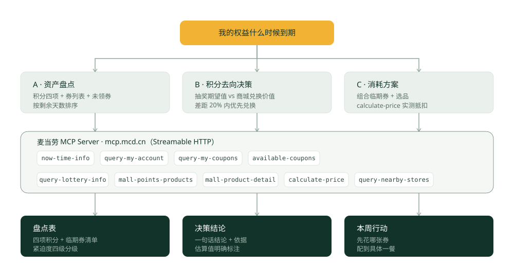

# mcd-asset-guard · 麦当劳权益到期管家


> 别人帮你算这一单怎么省，我帮你看账户里的东西**什么时候就没了**。

基于麦当劳中国 MCP 能力开发的 WorkBuddy Skill。它把麦当劳账户里的积分和优惠券当作**会过期的沉默资产**来管理：盘点清楚、算出时间价值、给出本周行动清单。

---

## 为什么做这个

你的麦当劳账户里大概率躺着这些东西：

- 一笔不知道什么时候过期的积分
- 几张领了就忘、过期才发现的优惠券
- 一批能领但一直没领的券

现有的麦当劳 MCP 项目基本都在解决「这一单怎么点更划算」。**没有人管时间维度**——而时间恰恰是这些资产归零的唯一原因。

这个 Skill 补的就是这一环。

## 和其他项目的区别

| | 常见的点餐 / 省钱 Skill | mcd-asset-guard |
|---|---|---|
| 关注点 | 这一单怎么省 | 账户里的东西什么时候没 |
| 时间维度 | 无 | 核心能力，按剩余天数四级分级 |
| 积分去向 | 列出可换的商品 | 抽奖资源账 vs 商城最低门槛的机会成本对比 |
| 还没领的券 | 不查 | 查 `available-coupons`，主动补漏 |
| 优惠规则 | 凭常识推断 | 一律用 `calculate-price` 实测验证 |
| 输出物 | 推荐一单 | 盘点表 + 决策结论 + 本周行动清单 |

---

## 目标用户

- 麦麦省的重度用户，账户里常年有券和积分
- 囤券党：领的时候很积极，用的时候全忘了
- 积分快过期才想起来的人

---

## 能力

### A · 资产盘点

一次查清四项积分（可用 / 累计 / 冻结 / 即将过期）、券列表（面额、门槛、有效期）、以及**还没领但能领的券**，按剩余天数排序。

### B · 积分去向决策

回答「积分该抽奖还是换商品」：

- 先算资源账：`可用积分 ÷ 单次消耗 = 能抽几次`
- 再算兑换侧：商城最低积分门槛是多少，够不够换
- **确定性优先**：积分只够换一件确定的东西时，不建议去赌概率

> 实测确认：抽奖奖品池**不含中奖概率字段**，期望值算不准；商城积分商品与现金商品互斥，
> **积分的现金汇率也无法推导**。所以这个 Skill 只做机会成本对比，
> 不会输出「每 100 积分 ≈ X 元」这种看着漂亮但推不出来的数字。

### C · 消耗方案

把临期券组合成具体的一餐，并用 `calculate-price` 实测抵扣后的金额，不靠猜。

### 紧迫度分级

| 级别 | 剩余天数 |
|---|---|
| 紧急 | ≤ 3 天 |
| 临近 | 4–7 天 |
| 关注 | 8–30 天 |
| 充裕 | > 30 天 |

---

## 安装

### 1. 申请麦当劳 MCP Token

访问 [https://open.mcd.cn/mcp](https://open.mcd.cn/mcp)，手机号登录后，在控制台点击「激活」申请 Token。

### 2. 在 WorkBuddy 里接入 MCP

打开 WorkBuddy → 左侧边栏【专家·技能·连接器】→【连接器】→ 右上角【自定义连接器】→【配置 MCP】，填入：

```json
{
  "mcpServers": {
    "mcd-mcp": {
      "type": "streamablehttp",
      "url": "https://mcp.mcd.cn",
      "headers": {
        "Authorization": "Bearer YOUR_MCP_TOKEN"
      }
    }
  }
}
```

替换为你的真实 Token，保存后启用 `mcd-mcp`。

### 3. 安装本 Skill

```bash
git clone https://github.com/<你的用户名>/mcd-asset-guard.git \
  ~/.workbuddy/skills/mcd-asset-guard
```

重启 WorkBuddy 后即可使用。

---

## 使用示例

以下均为真实运行结果，非构造示例。

**例 1 · 盘点**

> 帮我看看我麦当劳账户里有什么快过期了

```
## 你的麦麦资产（截至 2026-10-09）

### 积分
| 项目 | 数值 |
|---|---|
| 可用 | 85.4 |
| 本月将过期 | 0 |
| 下月将过期 | 0 |
| 已过期（沉没） | 607.6 |
| 冻结 | 0 |

> 已经过期的积分（607.6）是现在还剩下的（85.4）的 7 倍多。

### 今日到期的券
| 券 | 有效期至 | 紧迫度 |
|---|---|---|
| 麦旋风任选 ¥9.9 | 今天 23:59 | 紧急 |
| 薯薯任选 ¥9.9 | 今天 23:59 | 紧急 |

### 还没领的
当前没有未领取的券。

## 本周建议先花掉
1. 麦旋风任选 / 薯薯任选 —— 今晚 23:59 失效，今天就用掉
```

**例 2 · 决策**

> 这 85.4 积分是拿去抽奖还是换东西？

```
资源账：抽奖单次消耗 24 积分 → 可抽 3 次（用掉 72，剩 13.4）
兑换侧：商城最低门槛 50 积分 → 可换 1 件（用掉 50，剩 35.4）

结论：换成 6.9 元档的商品。
理由：你的积分只够换一件确定的东西，按确定性优先原则不建议去赌概率。
注：官方未公布抽奖概率，奖品池期望值无法可靠计算。
```

**例 3 · 消耗**

> 这些快过期的券怎么用最划算？

Skill 组合出 1–2 个方案，调 `calculate-price` 验证实付金额后再输出。

---

## 调用链路



---

## 项目结构

```
mcd-asset-guard/
├── SKILL.md                 # Skill 主体：流程、工具编排、计算规则、输出格式
├── README.md
├── MCP_INTEGRATION.md       # 使用的 MCP 工具与业务价值
├── CONTEST_DECLARATION.md   # 参赛声明（官方原文件，未改动）
├── mcp-config.example.json  # 脱敏配置示例
└── assets/                  # Logo / banner / 架构图
```

---

## 边界

- 所有数值来自 MCP 工具的实际返回。**字段拿不到就说明拿不到**，不做估算后当作事实陈述。
- 涉及领券、下单等写操作前，必须先向用户确认。
- 输出仅供参考，餐品信息、价格及供应状态以麦当劳官方渠道的实时结果为准。

---

## 声明

本项目为麦当劳程序员创意开发大赛参赛作品，由参赛者独立开发，**非麦当劳官方产品**。

本项目使用 [腾讯 WorkBuddy](https://www.workbuddy.cn) 开发，WorkBuddy 为本次活动官方合作伙伴。
